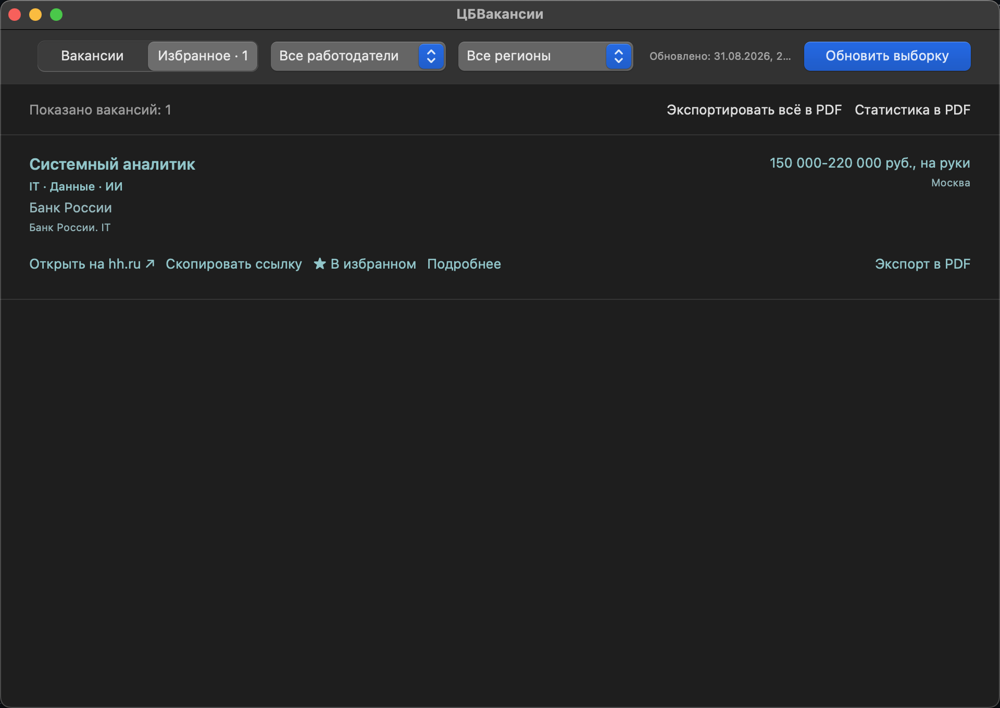

# ЦБВакансии

Самостоятельное приложение для macOS: сбор вакансий Банка России и подтверждённых связанных организаций через API hh.ru. Проект `HHVacancyCBR` создан на основе зафиксированной реализации `HHVacancySber`; для сборки и работы исходный проект не нужен. Приложение не является официальным продуктом Банка России или HeadHunter.

Версия **1.0 (1)**. Собственная история Git, Xcode-проект, схема, тесты, CI и выпуск DMG.



## Возможности

- Полная выгрузка по идентификаторам работодателей, постраничный сбор, дедупликация и контроль неполных результатов.
- Сохранённые географический справочник и классификация регионов, фильтры и сортировка.
- Классификация IT, данных, ИИ и информационной безопасности.
- Кеш регионов и снимок вакансий, избранное, просмотр подробностей и локальное хранение.
- PDF вакансий, избранного и статистики; имена файлов начинаются с `цбвакансии_`.
- Прежние обработка ошибок, ограничение частоты запросов, повторные попытки и отмена операций.
- Прежний интерфейс SwiftUI и архитектура ViewModel. Изменены название, значок и предметные подписи.

## Работодатели

Начальный `employers.json` содержит четыре подтверждённых аккаунта:

| hh.ru ID | Работодатель |
| --- | --- |
| 47858 | Банк России |
| 1654251 | НСПК |
| 125886 | Объединение РОСИНКАС |
| 2608647 | РНПК |

Основания включения, ссылки и ограничения охвата приведены в [реестре](docs/EMPLOYER_REGISTRY.md). Надзор Банка России сам по себе не является основанием включения коммерческого банка. Поиск выполняется по ID, а не по тексту названия. Автоматического обнаружения новых организаций нет.

## Сборка и тесты

Нужны Mac, macOS 13 или новее и Xcode 15.2 или новее. Релизный скрипт собирает Apple silicon (`arm64`). Внешних библиотек и пакетов нет.

Откройте `HHVacancyCBR/HHVacancyCBR.xcodeproj` и выберите схему `HHVacancyCBR`. Из корня репозитория:

```sh
python3 scripts/verify_independence.py
python3 -m unittest discover -s scripts/tests -v
xcodebuild -project HHVacancyCBR/HHVacancyCBR.xcodeproj -scheme HHVacancyCBR \
  -configuration Debug -destination 'platform=macOS,arch=arm64' \
  -derivedDataPath build/DerivedData CODE_SIGN_IDENTITY=- CODE_SIGN_STYLE=Manual DEVELOPMENT_TEAM= \
  test -only-testing:HHVacancyCBRTests
```

UI-тесты выполняются той же командой с `-only-testing:HHVacancyCBRUITests`. Для них нужен интерактивный сеанс macOS с разрешённой автоматизацией Xcode. Тестовые настройки имеют префикс `HHVACANCYCBR_`; fixtures, временные файлы и bundle ID принадлежат новому приложению. Опциональные сетевые тесты выключены по умолчанию. Их переменные описаны в исходном файле тестов и имеют тот же префикс.

Авторизация сохранена по прямому указанию владельца: application token хранится открытым текстом в `HHVacancyCBR/HHVacancyCBR/HHAuthConfig.swift` и входит в Git и сборку. Локальная конфигурация и обращение к исходному проекту не требуются. Код проверки не печатает значение токена.

## Независимое хранение

Продукт: `ЦБВакансии.app`. Bundle ID: `local.sergey.HHVacancyCBR`.

Контейнер App Sandbox:

```text
~/Library/Containers/local.sergey.HHVacancyCBR/Data/Library/Application Support/HHVacancyCBR/
  employers.json
  favorites.json
  areas.json
  vacancies.json
```

Первый запуск копирует только собственный встроенный `employers.json`. Последующие запуски используют свою локальную копию; после её удаления восстановится собственный список Банка России. Некорректный JSON вызывает явную ошибку. Старые списки и механизм миграции Сбера удалены. Переноса избранного, кешей и настроек другого приложения нет. При недоступности Application Support данные не перенаправляются во временный каталог.

Обе программы можно держать в `/Applications` и запускать одновременно. Их имена, bundle ID и каталоги данных различны. Удаление или обновление одного `.app` не меняет контейнер другого.

## Выпуск

Из чистого коммита:

```sh
scripts/release.sh --output-dir "$PWD/releases"
```

Скрипт экспортирует текущий коммит в отдельный временный каталог, собирает Release со строгой проверкой конкурентности и предупреждений, проверяет подпись и entitlements, создаёт `HHVacancyCBR_1.0_1_macos13_arm64.dmg` и `.sha256`. Существующие файлы не перезаписываются. Так проверяется сборка без исходного репозитория и без ссылок на рабочую копию.

По умолчанию используется подпись ad hoc без нотарификации Apple. Для подписанного распространения предусмотрены `DEVELOPER_ID` и `NOTARY_PROFILE`. Проверка контрольной суммы:

```sh
cd releases
shasum -a 256 -c HHVacancyCBR_1.0_1_macos13_arm64.dmg.sha256
```

Собственный CI проверяет конфигурацию, инструменты выпуска, Debug, Release и UI-тесты. Workflow `Release DMG` собирает установочный образ по тегу `v*` или ручному запуску и сохраняет его артефактом GitHub Actions.

[Происхождение и границы переноса](docs/PROVENANCE.md) · [Результаты проверки](docs/VALIDATION.md)
