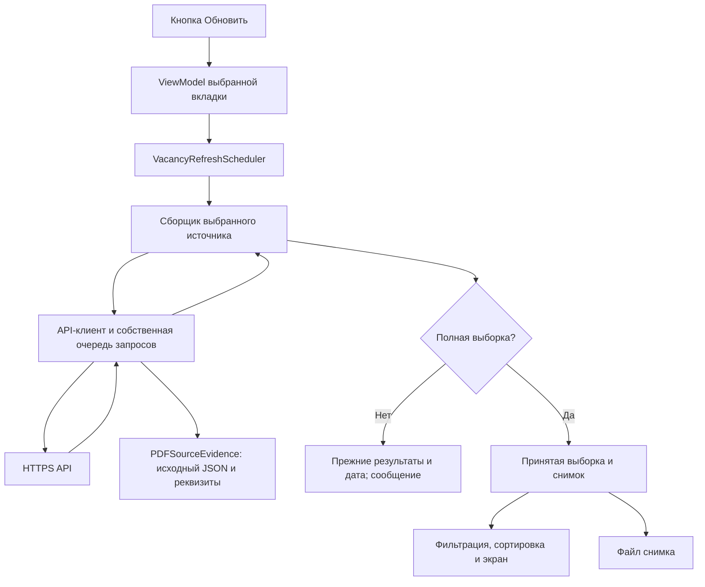

# Архитектура HHVacancyCBR

Приложение содержит один target приложения macOS и два независимых источника вакансий. SwiftUI показывает состояние двух `@MainActor` ViewModel; API-клиенты получают и сохраняют исходные ответы, сборщики проверяют полноту, хранилища записывают принятые выборки, а PDF-подсистема формирует документы с исходными материалами. Общий планировщик последовательно выполняет полные обновления обеих вкладок.

Файлы приложения находятся в [`HHVacancyCBR/HHVacancyCBR`](../HHVacancyCBR/HHVacancyCBR). Обозначения типов, протоколов, методов, ключей и файлов данных ниже соответствуют рабочему коду. Порядок сборки и проверки описан в [DEVELOPMENT.md](DEVELOPMENT.md) и [TESTING.md](TESTING.md); изменение идентичности продукта — в [FORKING.md](FORKING.md).

## Запуск и владение состоянием

[`HHVacancyCBRApp.swift`](../HHVacancyCBR/HHVacancyCBR/HHVacancyCBRApp.swift) содержит точку входа `@main`, окно и `@StateObject` для `VacancySearchViewModel`. [`AppComposition.swift`](../HHVacancyCBR/HHVacancyCBR/AppComposition.swift) создаёт зависимости hh.ru: `HHAPIClient`, `EmployerConfigurationStore`, `VacancySnapshotStore`. Для trudvsem.ru используется отдельный `TrudvsemViewModel` со своим клиентом и хранилищами.

[`ContentView.swift`](../HHVacancyCBR/HHVacancyCBR/ContentView.swift) владеет `@StateObject` trudvsem.ru и выбранным источником. Он переключает представления, сохраняя обе ViewModel. Его `.task` читает локальные данные через `loadPersistenceIfNeeded()` и `load()`; сетевого обновления при запуске или переключении вкладок нет. Фильтры принадлежат соответствующей ViewModel и сохраняются при переключении вкладок в текущем окне; в файлы снимков записываются вакансии, а не выбранные фильтры.

В Debug `AppComposition` может создавать синтетические клиенты при `HHVACANCYCBR_UI_TEST_MODE=1`. Они используют временные пути и сценарий из `HHVACANCYCBR_UI_TEST_SCENARIO`. Фикстуры оставлены в одном файле со сборкой зависимостей, чтобы сохранить их исходную `private`-видимость. Release не включает этот условный код. Перенос фикстур в отдельный модуль сейчас не нужен.

## Карта компонентов

| Область | Файлы и основные типы | Ответственность |
|---|---|---|
| Идентичность источников и организаций | `OrganizationRegistry.swift`: `VacancySource`, `Organization`, `OrganizationRegistry` | Порядок организаций, реквизиты, соответствие HH ID и ключей организаций, подтверждённые профили trudvsem.ru |
| HH-транспорт | `HHAPIClient.swift`: `HHVacancyAPIClient`, `HHVacancySearchRequest`, `HHAPIClient`, `HHRequestGate` | Запросы, авторизация через `HHAuthConfig`, декодирование, повторы, общая очередь обращений |
| HH-модели ответа | `HHModels.swift` | `HHVacancySearchResponse`, `HHVacancySummary`, `HHVacancyDetails` и вложенные Codable-типы; ключи JSON, терпимое чтение отдельных повреждённых записей |
| География HH | `AreaDirectoryStore.swift`, `VacancyLocation.swift` | Версионированный кэш регионов, индекс дерева, классификация региона, подписи и ключи фильтров |
| HH-представление записи | `VacancySearchResult.swift` | Объединение краткой и полной карточки, состояние деталей, архивность, классификация и связь с исходными ответами |
| Форматирование и классификация | `VacancyFormatting.swift`, `VacancyText.swift`, `FieldInstitutionClassifier.swift` | Дата и количество на экране, чтение дат HH, преобразование HTML в текст, доказательная классификация полевых учреждений |
| HH-сбор | `VacancyCollectionService.swift`: `VacancyCollectionService`, `CollectionRunClient` | Полнота, пагинация, разбиение больших выдач, дедупликация, дополнительный поиск полевых учреждений, бюджет запросов |
| trudvsem-транспорт | `TrudvsemAPIClient.swift`: `TrudvsemAPI`, `TrudvsemAPIClient`, `TrudvsemRequestGate` | HTTPS по ИНН, параметры страниц, повторы, общий сетевой cooldown и ограничение времени страницы |
| trudvsem-модели и сбор | `TrudvsemModels.swift`, `TrudvsemCollectionService.swift` | Неоднородные значения JSON, DTO, пользовательская запись, проверка компаний, полнота и метрики шести организаций |
| Хранилища | `ApplicationSupportLocation.swift`, `EmployerConfiguration.swift`, `TrudvsemEmployerConfiguration.swift`, `VacancySnapshotStore.swift`, `TrudvsemSnapshotStore.swift` | Размещение файлов, исходные конфигурации, существующие миграции, проверка версий, атомарная замена снимков |
| Координация обновлений | `VacancyRefreshScheduler.swift` | Общая FIFO-очередь полных обновлений, передача разрешения, отмена ожидающих задач |
| Состояние экранов | `VacancySearchViewModel.swift`, `TrudvsemViewModel.swift` | Фильтры и поиск, обновление и отмена, публикация результатов, экспорт и доступность команд |
| Представления | `VacancySearchViews.swift`, `TrudvsemViews.swift`, `VacancySharedViews.swift` | Две вкладки и общие элементы панелей, карточки, сообщения, команды PDF |
| PDF-форматирование | `VacancyPDFStyle.swift`, `PDFFileNameBuilder.swift`, `VacancyPDFFormatter.swift`, `TrudvsemPDFFormatter.swift`, `VacancyStatisticsReport.swift`, `VacancyPDFDocumentBuilder.swift`, `VacancyHTMLAttributedText.swift` | Оформление, имена, текст карточек и статистики, HTML, сборка документа |
| PDF-выполнение | `PDFExportModels.swift`, `PDFExportWorker.swift`, `PDFNewFileWriter.swift`, `VacanciesPDFExporter.swift` | Снимки данных, фоновая подготовка, постраничный рендер, безопасная запись и диалоги выбора места |
| Исходные материалы | `PDFSourceEvidence.swift`, `PDFOriginalMaterials.swift`, `Vendor/Streebog` | Исходные JSON, реквизиты получения, Streebog-512, проверка связи с вакансиями и включение материалов в PDF |

`HHModels.swift` сохраняет транспортные типы целиком, включая их небольшие вычисляемые свойства. Это оставляет `CodingKeys`, инициализаторы и приватные форматтеры в исходных границах типов. `VacancySearchViewModel` сохраняет связанное состояние запросов деталей и экспорта в одном классе: механический перенос его методов в раздельные файлы потребовал бы расширить доступ к private-состоянию и усложнил бы проверку отмены.

## Путь обновления

Эта схема обозначает связи; порядок публикации и записи для источников различается и сохраняется в коде:

- **hh.ru:** `performSearch(useCache:)` сначала загружает конфигурацию и справочник регионов, затем запускает `VacancyCollectionService`. При полном результате публикует `results`, кэш и дату, после чего сохраняет `VacancySnapshot` через `Task.detached`. Ошибка записи становится `snapshotWarning`; исходный порядок публикации не меняется рефакторингом. Обычный `search()` может использовать свежий полный кэш, а кнопка вызывает `refreshVacancies()` с `useCache: false`.
- **trudvsem.ru:** `refresh()` запускает `TrudvsemCollectionService`, проверяет полноту, сохраняет подтверждённые коды компаний и `TrudvsemSnapshot`, затем публикует метрики, вакансии и дату без точки приостановки между записью снимка и публикацией. При ошибке или отмене прежняя выборка остаётся.

Фильтры и локальный текстовый поиск работают поверх полученной выборки. Их изменение не запускает обновление API. Оба источника сортируют сначала по дате, но детали сравнения одинаковых дат и названий заданы отдельно в существующих реализациях; объединять эти алгоритмы без проверки контракта нельзя.

HH-сборщик сначала читает страницы работодателей в России, а подтверждённые самостоятельные аккаунты полевых учреждений — без этого ограничения. Большие выдачи разбиваются по поддерживаемым признакам. Дополнительный поиск полевых учреждений ограничен двумя страницами; совпадение текста само по себе не является подтверждением классификации. trudvsem-сборщик использует ИНН, проверяет сведения о компании и отдельные метрики каждой организации. Эти сборщики не являются взаимозаменяемыми.

## Конкурентность и отмена

Все публикуемые состояния экранов принадлежат `MainActor`. ViewModel владеют своими `Task` обновления, карточки или экспорта, а обработчики кнопок отменяют эти задачи. Освобождение владения и сброс индикаторов находятся в соответствующих `defer` и обработчиках завершения.

`VacancyRefreshScheduler` — общий `@MainActor`-планировщик двух источников. `acquire()` выдаёт одно разрешение, остальные continuation помещаются в FIFO-очередь. Отмена удаляет ожидающего; при гонке отмены с передачей разрешения оно возвращается через `release()`. Состояние вкладок независимо, но полные обновления не выполняются параллельно.

На следующем уровне `HHRequestGate` и `TrudvsemRequestGate` обслуживают ограничения своих API. Они не заменяют общий планировщик. HH держит очередь запроса и повторов совместно; trudvsem отдельно учитывает интервалы, указанный сервером `Retry-After` и временную недоступность API. Пределы попыток, тайм-ауты и обработка ошибок остаются в клиентах. Для trudvsem таймер страницы включает ожидание очереди, повторов и сетевого ответа.

HH-запросы подробностей объединяются в `sharedDetails`: несколько потребителей подписываются на один запрос. Отмена одного подписчика не отменяет остальных; сетевой запрос прекращается после отмены последнего. Номер ревизии результатов не позволяет старой карточке перезаписать новое состояние. Эта часть находится рядом с состоянием ViewModel, чтобы сохранять явное владение продолжениями и задачами.

`PDFExportWorker` является actor и хранит временно подготовленные части экспорта. Диалоги AppKit остаются на `MainActor`. Снимки `PDFVacancySnapshot` и `PDFVacanciesSnapshot` фиксируют входные данные до работы рендера; существующие `@unchecked Sendable` границы сохранены. Приватные `VacanciesPDFExporter.Page` и `PageLayout` остаются с рендером, их видимость не расширена для разделения файлов.

## Хранение и совместимость

Базовый путь задаёт `ApplicationSupportLocation.fileURL(named:fileManager:)`: системный Application Support плюс каталог `HHVacancyCBR`. В установленной sandbox-сборке это `~/Library/Containers/local.sergey.HHVacancyCBR/Data/Library/Application Support/HHVacancyCBR`. Тесты передают отдельные временные URL через существующие инициализаторы хранилищ.

| Файл или каталог | Назначение и контракт |
|---|---|
| `employers.json` | Конфигурация HH; bundled default, поддерживаемые пользовательские дополнения и существующая миграция версии |
| `employers-trudvsem.json` | Конфигурация trudvsem.ru, ИНН/ОГРН, подтверждённые коды компаний; обновление сведений по реестру с сохранением предусмотренных данных |
| `areas.json` | Версионированный справочник географии HH и дата его получения |
| `vacancies.json` | HH-снимок: краткие карточки, местоположение, уже загруженные детали, issues и дата; даты кодируются ISO 8601 |
| `vacancies-trudvsem.json` | trudvsem-снимок: записи с исходными полями, метрики и дата; используется исходная стратегия JSONEncoder для Date |
| `documented-archive-v1/observations` | Append-only директории с `observation.json` и точными `response.json` |

Снимки заменяются атомарно. Хранилища проверяют поддерживаемую версию и свои ограничения целостности. Повреждённые или будущие версии не преобразуются новой миграцией при этом рефакторинге. Исторические данные других функций и приложений не участвуют в загрузке этих снимков.

Детали HH могут сохраняться отдельно после открытия карточки: `snapshotSaveTask` откладывает запись и сохраняет прежнюю дату полного обновления. Это не новое сетевое обновление всей выборки. Повторное открытие приложения читает локальные снимки; отсутствие сети не мешает чтению уже сохранённых данных.

## Путь PDF и исходные материалы

1. ViewModel фиксирует состав отображаемой выборки и фильтры. Для HH массовый экспорт предварительно получает необходимые полные детали; переключение фильтров не меняет уже зафиксированный состав.
2. `VacancyPDFFormatter`, `TrudvsemPDFFormatter` и `VacancyStatisticsReport` формируют содержимое. `VacancyPDFDocumentBuilder` применяет общие стили, подписи и ссылки; `VacancyHTMLAttributedText` обрабатывает HTML.
3. `PDFExportWorker` подготавливает документы и страницы. Рендер учитывает переносы длинных карточек, продолжения и предел 100 страниц в части массового экспорта.
4. `PDFSourceEvidence` проверяет реквизиты, хеши и соответствие наблюдений контексту документа. `PDFOriginalMaterials` включает исходные байты JSON в `EmbeddedFiles` готового PDF. Прежние предупреждения и отказы при недостающем или повреждённом материале сохраняются; из нормализованного снимка новый «исходный ответ» не создаётся.
5. `PDFFileNameBuilder` строит имена, `PDFNewFileWriter` создаёт новые файлы с разрешением коллизий и без перезаписи. При отмене или сбое удаляются только созданные текущей операцией файлы с проверкой их идентичности. `discardPreparedExport()` освобождает подготовленные временные части.

`PDFSourceEvidence` защищает транзакции рекурсивной блокировкой. Завершённая директория наблюдения появляется после переименования staging-каталога. В неё попадают только разрешённые ответы вакансий, параметры запросов и реквизиты получения; заголовки авторизации и токен не сохраняются. `MaterialHash` использует Streebog-512 через неизменённый C bridge и сохраняет поддержку ранее допустимых алгоритмов при чтении. Совпадение хеша проверяет целостность материала, а не подтверждает его происхождение или время получения.

Подробнее о составе документов и ограничениях исходных материалов — [DOCUMENTED_PDF.md](DOCUMENTED_PDF.md). Код сторонней реализации и его происхождение описаны в [`Vendor/Streebog/PROVENANCE.md`](../HHVacancyCBR/HHVacancyCBR/Vendor/Streebog/PROVENANCE.md).

## Точки изменения и расширения

Для изменения организаций сначала согласуют `OrganizationRegistry`, bundled `employers.json`, классификатор полевых учреждений, тесты и проверку независимости. Одного изменения подписи на экране недостаточно: идентификаторы участвуют в фильтрах, проверке компании, классификации, снимках и PDF.

Новый источник потребовал бы собственного контракта клиента, DTO, проверки полноты, хранилищ и ViewModel, а также подключения к `VacancySource`, `AppComposition`, `ContentView`, общей очереди обновлений, представлениям, доказательным материалам и PDF. Общие элементы интерфейса находятся в `VacancySharedViews`; специфичные правила источника должны оставаться в его реализации. Рефакторинг не добавляет новый источник или систему плагинов.

Для тестирования существующие протоколы клиентов, хранилищ и экспортера принимают синтетические реализации. Время, интервалы, URLSession/transport и пределы запросов инъецируются там, где они уже предусмотрены. Изменение схем данных, пользовательских строк, интенсивности сети, порядка публикации или конкурентности требует отдельного функционального изменения и проверок; перенос файлов сам по себе их не меняет.
